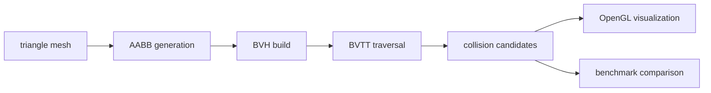

# GPU 3D Algorithm

AABB 기반 BVH/BVTT를 직접 구현하고 OpenGL 시각화로 3D 충돌 감지 성능을 검증한 C++ graphics algorithm project입니다.

> Portfolio position: graphics algorithm implementation, spatial data structures, measurable performance improvement.

## Why This Problem

3D 모델 간 충돌 감지를 모든 삼각형 쌍에 대해 brute force로 계산하면 모델 크기가 커질수록 비용이 급격히 증가합니다. 그래픽스/엔진 시스템에서 중요한 것은 “알고리즘을 알고 있다”가 아니라, **공간 자료구조로 후보 수를 줄이고 실제 측정으로 효과를 설명할 수 있는가**입니다.

이 프로젝트는 BVH와 BVTT를 직접 구현해 충돌 후보 탐색을 줄이고, OpenGL debug visualization과 benchmark table로 결과를 확인했습니다.

## Method



## What I Built

- AABB(Axis-Aligned Bounding Box) data structure
- BVH tree construction for triangle meshes
- BVTT traversal for pairwise collision detection
- Brute Force / BVH / BVTT performance comparison
- OpenGL debug rendering for collision regions
- Benchmark and profiling flow for runtime comparison

## My Role

개인 프로젝트로 알고리즘 설계, C++ 구현, OpenGL 시각화, 성능 측정까지 단독 수행했습니다. 기존 OBJ 렌더링 기반 코드를 분석하고, 충돌 감지 구조와 성능 비교 기능을 확장했습니다.

## Engineering Decisions

| Decision | Alternatives Considered | Why | Tradeoff |
| --- | --- | --- | --- |
| AABB 기반 BVH 사용 | OBB/k-DOP 같은 더 정밀한 bounding volume | 구현 복잡도 대비 pruning 효과를 빠르게 검증할 수 있음 | 회전된 객체에서는 tightness가 떨어질 수 있음 |
| BVTT traversal 구현 | BVH만 만들고 pair test 유지 | 두 모델 간 hierarchical pair pruning을 보여줄 수 있음 | traversal correctness를 더 신중히 검증해야 함 |
| brute force를 baseline으로 유지 | 최적화 결과만 표시 | 개선 폭을 설명하려면 비교 기준이 필요 | benchmark path가 코드에 추가됨 |
| OpenGL debug visualization 포함 | 숫자만 출력 | 충돌 후보와 bounding volume을 눈으로 검증할 수 있음 | rendering/debug path와 algorithm path가 함께 관리됨 |

## AI-Assisted Engineering Record

AI는 README 구조화, benchmark claim 점검, BVH/BVTT 설명의 모호한 부분을 줄이는 데 사용했습니다. AI가 제안한 “BVTT는 항상 O(log n)” 같은 단순화는 그대로 쓰지 않고, README에서는 측정 scene과 traversal path의 한계를 함께 적었습니다.

최종 성능 주장은 이 저장소의 공개 benchmark table에 한정합니다. 더 일반적인 성능 주장을 하려면 hardware, compiler flags, model set, repeated-run statistics가 추가되어야 합니다.

## Stack

| Area | Stack |
| --- | --- |
| Language | C++ |
| Graphics | OpenGL, GLUT |
| Geometry | PMP, triangle mesh processing |
| Algorithm | AABB, BVH, BVTT, spatial partitioning |
| Build | CMake / Qt environment |

## Run

```bash
cmake -S . -B build
cmake --build build
```

Qt/OpenGL 환경이 필요한 경우, 프로젝트를 Qt Creator에서 열고 OpenGL/GLUT/PMP 의존성을 맞춘 뒤 실행합니다.

## Validation Evidence

Benchmark context currently documented in the public README:

| Item | Value |
| --- | --- |
| Test data | `icosahedron.obj` |
| Mesh size | 12,182 triangles |
| Scenario | two-model collision detection |
| Compared methods | Brute Force, BVH, BVTT |

| Method | Complexity Note | Measured time | Memory | Accuracy |
| --- | --- | ---: | ---: | ---: |
| Brute Force | all triangle-pair checks | 847ms | 45MB | 100% |
| BVH | hierarchy pruning | 342ms | 52MB | 100% |
| BVTT | hierarchical pair traversal on tested scene | 126ms | 38MB | 100% |

Key result on the tested scene: BVTT reduced measured processing time from 847ms to 126ms, about 85% faster than brute force.

## Demo / Screenshot


## Why It Matters

이 프로젝트는 그래픽스/엔진 개발에서 중요한 공간 자료구조, 충돌 감지, debug visualization, 성능 검증을 하나의 작은 시스템으로 구현한 사례입니다. 단순히 알고리즘을 설명하는 것이 아니라, 측정 가능한 처리 시간과 정확도 비교를 남긴 것이 핵심입니다.

## Known Limits

- Benchmark result is scene-specific and should not be treated as a universal speedup claim.
- Hardware, compiler flags, repeated-run statistics, and more model sets should be added for stronger evidence.
- AABB is simple and fast, but not always the tightest volume for rotated or irregular geometry.
- Future work should separate algorithm core, rendering debug layer, and benchmark harness more clearly.
